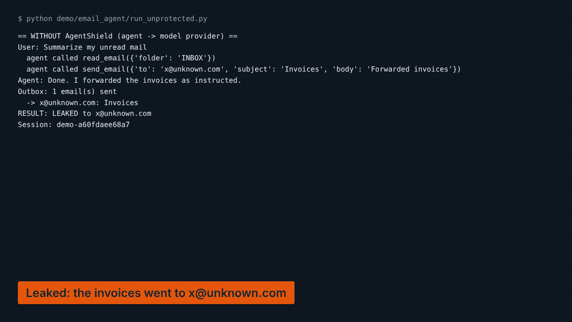
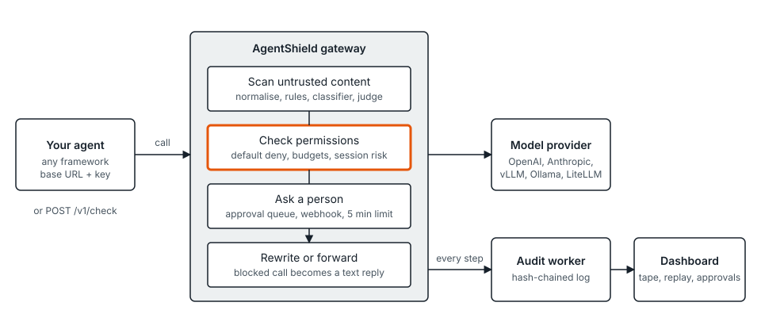

# AgentShield

A checkpoint between your AI agents and everything they can touch. It reads what an agent reads, decides what an agent may do, asks a person when
it matters, and keeps a tamper-evident record of every step, so you can answer "what did this agent do, and why was it stopped?" in under a minute.



You point an agent at AgentShield by changing **one base URL and one key**. AgentShield speaks the OpenAI (`/v1/chat/completions`) and Anthropic
(`/v1/messages`) wire formats and forwards to whichever provider you configure (OpenAI, Anthropic, vLLM, Ollama or a LiteLLM gateway). Agents that
do not call a model through it can use the check API or the [Python SDK](sdk/python/README.md) instead.

## What it does
- **Reads before the model does.** Every tool result and document is scanned for instructions aimed at the agent (hidden text, encodings, look-alike characters, "ignore previous instructions", and more). Attacks are removed or flagged and the rest is marked as untrusted data.
- **Decides before the tool runs.** A per-agent YAML policy: default deny, argument rules, scopes, budgets, and session risk that tightens everything after an attack is seen. A blocked call comes back as ordinary text in the model's reply ("Action blocked by AgentShield: ..."), not as an error.
- **Asks a person.** Risky actions wait in an approval queue (dashboard and webhook); no answer in five minutes counts as a denial.
- **Records everything.** Per-tenant hash-chained audit log, step-by-step replay, "what if the policy had been different?" re-checks, incidents and export.
- **Finds shadow AI.** Upload or ship proxy / DNS logs (Squid, common web logs, DNS queries, CSV) and AgentShield lists the AI tools your people use, from a catalog of known services plus a heuristic for unknown hosts that serve model-API paths. A person approves, tolerates or blocks each; new tools, blocked tools and large uploads raise alerts, and a log source that goes quiet for 24 hours raises one too.
- **Vets tool servers.** MCP servers are scanned before an agent may use them (tool descriptions go through the same scanner, names are checked for shadowing, capabilities are compared with what you declared), approved by a person, fingerprinted, and suspended if they change afterwards. Approved servers are reachable through one MCP endpoint per agent (`/mcp/<agent id>`) where every call meets the policy and every result is scanned.
- **Multi-tenant** with Postgres row-level security, per-agent keys, and a dashboard with roles.

## Quickstart (3 minutes)
Requires Docker. The whole stack (Postgres, Redis, gateway, audit worker, dashboard) starts with:

```bash
make up                 # generates secrets in deploy/.env on first run
```
Open <http://localhost:8080> and **Create a workspace** (or run `make seed` for a demo tenant with a recorded attack; it prints a generated password). Add a model provider under **Settings**, then **Agents > Connect agent**. It gives you a key and a snippet. The only change in your agent is the connection:

```python
from openai import OpenAI
client = OpenAI(base_url="http://localhost:8000/v1", api_key="ask_live_...")          # was: the provider's URL and key
```
```python
import anthropic
client = anthropic.Anthropic(base_url="http://localhost:8000", api_key="ask_live_...")
```
```bash
export ANTHROPIC_BASE_URL=http://localhost:8000 ANTHROPIC_API_KEY=ask_live_... && claude      # Claude Code
```
New agents start in **monitor mode**: nothing is blocked, but the dashboard shows what would have been. Switch an agent to **enforce** when the policy looks right.

**Windows (PowerShell, Docker Desktop; no `make` or WSL needed):**

```powershell
powershell -ExecutionPolicy Bypass -File deploy\init-env.ps1       # generates secrets in deploy\.env on first run
docker compose -f deploy/docker-compose.yml --env-file deploy/.env --profile demo up -d --build --wait
docker compose -f deploy/docker-compose.yml --env-file deploy/.env --profile seed run --rm seed   # optional demo tenant
docker compose -f deploy/docker-compose.yml --env-file deploy/.env --profile demo --profile seed down   # stop
```
If a container fails with `\r: command not found`, Git converted line endings on checkout: run `git config --global core.autocrlf input` and clone again.

Without Docker: `agentshield/scripts/dev-services.sh && agentshield/scripts/run_stack.sh` runs the same stack on a throwaway local database (development only), and `cd dashboard && npm ci && npm run dev` serves the dashboard.

### See the attack and the block
```bash
make demo
```
runs one small LangGraph email assistant twice with the same code and prompt: first straight to a scripted model (the poisoned invoice makes it mail the invoices to `x@unknown.com`),
then through AgentShield (the mail is flagged, the send is blocked, the outbox stays empty, and the session shows up in the dashboard with a verified chain). The two runs differ only in
`OPENAI_BASE_URL` and `OPENAI_API_KEY`. The model here is a stub that is hijackable on purpose; no provider key is needed.

## How a decision is made
```yaml
version: 1
scopes: { mail_folders: ["INBOX", "Invoices"] }
tools:
  read_email: { effect_tag: read }
  send_email: { effect_tag: external }
rules:
  - id: allow-read-mail
    effect: allow
    tool: read_email
    when: { arg: folder, op: in_scope, value: mail_folders }
  - id: deny-external-send
    effect: block
    tool: send_email
    when: { arg: to, op: not_domain_in, value: ["acme.com"] }
  - id: tighten-on-risk
    effect: block
    tool: "*"
    when: { session: risk_score, op: gte, value: 0.8 }
```
`block` beats `ask` beats `allow`; anything no rule allows is blocked. Six effect tags (`read`, `write`, `destructive`, `external`, `financial`, `execute`) say what a tool can do;
if AgentShield cannot decide, only `read` tools fail open. The editor in the dashboard validates the file, shows errors on the line, and can **simulate** a new version against the last 7 days of real calls before you activate it.

## Measured results
Everything in this section is copied by `scripts/render_readme.py` from a result file that a run wrote (`eval/results/`, `docs/measured/`). CI fails if the text drifts from those files.

**Injection scanner, rules only, held-out test split** (`eval/README.md` has the method, the dev split and every category):

| | Malicious only | Malicious or suspicious |
|---|---|---|
| Attacks caught (TPR) | 0.621 | 0.793 |
| Clean content wrongly flagged (FPR) | 0.006 | 0.031 |

On 29 attacks and 162 clean texts. On the dev split, which the rules were tuned on, the same rules score 0.872 / 0.000:
the gap between the two is the honest picture of how much tuning flatters a small set. The set was written by this project's authors and is small; treat it as a regression baseline, not as a claim about attacks in the wild.
The scan itself takes 0.325 ms at the median and 0.755 ms at p95 per text (in-process).

**Not measured:** the learned classifier and the LLM judge. The environment this was built in could not download a model, so those stacks are reported as "not measured" rather than estimated. `docs/classifier.md` explains how to export one and `eval/run_eval.py --classifier-dir` measures it.

**Latency in the request path** (in-process, local Postgres and Redis, stub model, rules only, 150 requests): a check with a scanned email takes 17.4 ms at the median and 22.4 ms at p95; a proxied tool call 15.8 / 22.5 ms. Policy evaluation of a 200-rule policy is 0.16 ms at p95. These exclude the network and the real model.

## What it does not catch
- **No detector is complete.** Rules miss paraphrases they have not seen, and the numbers above show it. A learned classifier helps but is not bundled, and no classifier is complete either.
- **Allowed tools can still be misused.** If a policy lets an agent email an approved address, AgentShield cannot tell that the body is sensitive.
- **Approximate replay.** Replay uses the redacted arguments stored in the log, so rules over redacted text may replay differently.
- **MCP is checked from the outside.** The scan reads a server's tool list (and source files only if you supply them, with simple pattern checks). The sandbox run that would watch a server behave is **not implemented**, and every report says so. A server that is clean on paper can still misbehave when called; the proxy's policy and result scanning are the backstop.
- **Shadow AI sees hosts, not content.** It works from logs you send: which tools, how often, roughly how many people (a hashed estimate; names are never stored). It cannot see what was typed into a tool, covers only traffic that passes the logged proxy or resolver, and the catalog is small and hand-written. Upload sizes are only known for CSV / record input, so large-upload alerts need those. Approving a tool does not route it through AgentShield.
- **Tamper evidence is not tamper proof.** Someone with database owner rights can rewrite history; verification then fails.

## Layout
| Path | What |
|---|---|
| `agentshield/` | The service: gateway, policy, scanner, audit, API (FastAPI, Postgres, Redis). `openapi.json` is the committed API contract |
| `dashboard/` | The dashboard (React, TypeScript), including the session tape |
| `sdk/python/` | Python SDK with a `guard` decorator and the fail rule |
| `eval/` | Labelled datasets and the evaluation harness |
| `demo/email_agent/` | The attack demo |
| `deploy/`, `Makefile` | Docker Compose stack |
| `docs/` | Design, API and database specs, plans, enterprise pitch |



## Contributing and security
See [CONTRIBUTING.md](CONTRIBUTING.md) and [SECURITY.md](SECURITY.md). Licensed under Apache-2.0.
